<div align="center">



<br>

<a href="https://github.com/JH3RSON/ImaLoader-Android/releases/latest"></a>
<a href="https://github.com/JH3RSON/ImaLoader-Android/releases"></a>


</div>

<br>

**ImaLoader** is a free, open-source downloader for Android, made by [IMA](https://github.com/JH3RSON). Paste a link or search inside the app, pick the quality and save it. Video and music from YouTube, YouTube Music, TikTok, Instagram, Facebook and X, in the best quality each one serves.

No ads, no account, no tracking. Everything goes straight to your phone.


## $ ls features/

### Video up to 4K 60 fps HDR

For every link, ImaLoader asks the source what it really has and lists exactly that, from the highest quality down. If a video has no 4K, you will never see a 4K option. Sizes and bitrates come from the source, not from a guess.

### Music in the best quality YouTube sends

Pick the format you want: Opus, AAC, MP3 and more. Opus is the one to choose for top quality, since YouTube's best audio is usually Opus at around 160 kbps. Every track gets its title, artist, album and cover art.

### Search without leaving the app

A YouTube tab and a YouTube Music tab, with suggestions while you type. Find it, play it, download it.

### Official audio finder

Paste the link of a music video and ImaLoader notices it's a song. It offers to look up the official audio on YouTube Music, with the official metadata and the square album cover, and you can download that one instead. If it can't find the official track, it tells you and you keep the audio of the video you pasted. Links from YouTube Music give the cleanest metadata.

### Yours to customize

Light, Dark, Material, ImaLoader and Retro themes, plus an Automatic mode that follows your phone's light and dark setting.

### Light and native

Written in Kotlin for Android, so it opens fast and goes easy on the battery. Files are saved directly to your device, ready to play offline.


## $ cat supported.txt

| Source | Video | Audio |
|:--|:--|:--|
| YouTube | Up to 4K 60 fps HDR, when the video has it | Opus, AAC, MP3 and more |
| YouTube Music | Official audio only | Official track, album cover and metadata |
| TikTok | Best quality available | Extracted from the video |
| Instagram | Reels and posts, best quality available | Extracted from the video |
| Facebook | Best HD stream available | Extracted from the video |
| X | Best quality available | Extracted from the video |

What you get always depends on what each site serves for that file. ImaLoader shows what's there and nothing else.


## $ ./install.sh

1. Download the APK from [Releases](https://github.com/JH3RSON/ImaLoader-Android/releases/latest).
2. Open it. If Android asks, allow installs from your browser or file manager.
3. Paste a link or use the search tab.

<!--
## $ ls screenshots/

<p align="center">
  
  
  
  
</p>
-->


## $ whoami

I'm IMA. I make Android apps and work on custom ROM support for Google Pixel phones. ImaLoader is one of my projects, and the code is open, so you can read exactly what it does. Ideas and bug reports are welcome. You'll find the rest on [my profile](https://github.com/JH3RSON), like [ALMA](https://github.com/JH3RSON/ALMA), an offline journal.

## $ ./contact.sh

Found a bug or have an idea? Tell me on Telegram. If ImaLoader saved you some time, you can buy me a coffee.

<p align="center">
<a href="https://t.me/IMA_2830"></a>
<a href="https://ko-fi.com/ima28"></a>
</p>


## $ ./build.sh

```bash
git clone https://github.com/JH3RSON/ImaLoader-Android.git
cd ImaLoader-Android
./gradlew assembleDebug
```

The APK lands in `app/build/outputs/apk/debug/`.

## $ cat credits.txt

ImaLoader runs on [yt-dlp](https://github.com/yt-dlp/yt-dlp) and [FFmpeg](https://ffmpeg.org). The app is inspired by [Seal](https://github.com/JunkFood02/Seal). License: see [LICENSE](LICENSE).

ImaLoader is meant for saving content you're allowed to save. It isn't affiliated with YouTube, TikTok, Instagram, Facebook or X.

<div align="center">

<sub>Made by IMA 🐭</sub>

</div>
